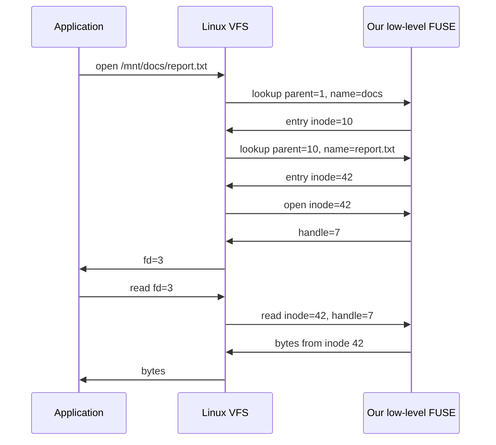
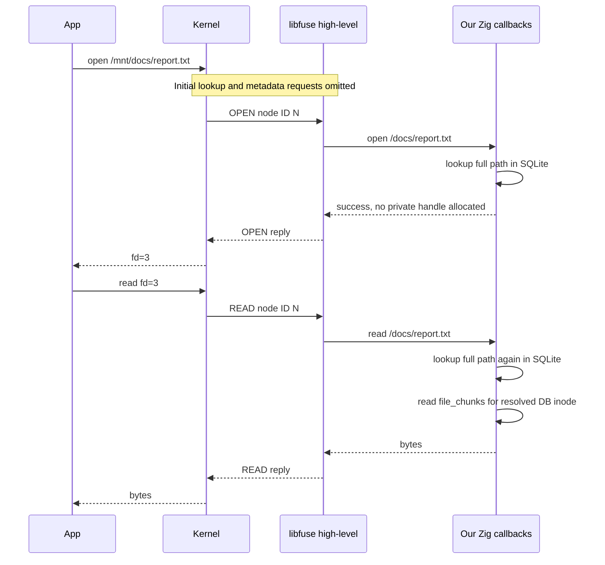

# FUSE workflows: current and planned

The current implementation uses libfuse3's high-level, pathname-oriented API. The user selected Linux-style unlink lifetime through the low-level, inode-oriented API as the next design direction; that migration and unlink are **not implemented yet**.

These diagrams are conceptual request flows, not runtime traces. They omit permissions, some metadata requests, and error handling. Cached names or data can avoid requests shown here. Paths passed to our callbacks are relative to the FUSE mount root: `/mnt/docs/report.txt` becomes `/docs/report.txt` when mounted at `/mnt`.

## Planned: low-level FUSE path lookup, open, and read

The application starts with a pathname. Linux resolves it one component at a time. After reaching the mount root, the kernel asks our filesystem for each child's inode, unless a valid cached entry already exists.

- FUSE reserves inode number 1 for the mount root. The adapter must map the database root in `fs_meta` to that identity, and map all other inode IDs consistently. The other inode numbers above are illustrative.
- `lookup(parent, name)` queries `dirents` and returns an entry with the target inode and its attributes. It is not a full-path lookup.
- Application FD 3, filesystem-private handle 7, and inode 42 are different identifiers. The kernel manages application descriptors; our process manages handle state.
- Subsequent reads use the inode and handle. They do not need to resolve the original name again.
- The diagram collapses libfuse's low-level dispatch into our callback participant. We still use libfuse in userspace; this is not a kernel driver.

## Existing: high-level FUSE open and read

The kernel already sends inode/node-ID-based FUSE protocol requests today. The high-level libfuse layer maintains its own name/parent mappings and translates requests into pathname callbacks for our Zig code.

The diagram starts after the initial kernel path walk. During that walk, high-level libfuse services lookup requests using our `getattr` callback with constructed paths such as `/docs` and `/docs/report.txt`. Our code resolves each supplied path against SQLite.

### What the existing code actually does

In `src/mount.zig`:

1. `open(path, fi)` calls `lookup(path)` for an ordinary open. An `O_TRUNC` open instead delegates to `truncate`, which also resolves the path.
2. `lookup(path)` starts at the database root and walks the path components using `dirents`, loading inode metadata along the way.
3. No private open handle is allocated; `fi->fh` is not populated by our code.
4. `read(path, ...)` calls `lookup(path)` again before reading the resolved inode's chunks.
5. There is no `release` callback or runtime inode-reference tracking yet.

The kernel/libfuse node ID `N` above is **not necessarily the SQLite inode ID**. Our high-level `getattr` fills `st_ino`, but that field does not by itself select the internal FUSE node identity.

The application still uses an FD for reads. It is libfuse's high-level adapter that supplies a pathname to our callback, and our code that re-resolves that pathname in SQLite—not the application or kernel restarting the original path walk for every read.

## Why the change matters for unlink

| Concern | Current high-level implementation | Planned low-level implementation |
|---|---|---|
| Child lookup | libfuse constructs paths; our code walks them | Our callback receives parent inode + child name |
| Open-file reads | Our callback resolves the supplied path again | Our callback uses inode + open handle |
| Open state | No private handle tracking | Handle-to-inode state and open references |
| Kernel inode references | Managed internally by high-level libfuse | Our adapter accounts for entry replies and `forget` |
| Unlink | Not implemented | Remove the name; retain the referenced inode |

High-level libfuse normally handles deletion of an open file by renaming it to a `.fuse_hidden…` name and deleting that name after release. Our rename callback is also unimplemented, so that mechanism is not a working unlink solution in the current project. Merely disabling hiding does not replace proper inode-lifetime handling.

With the planned low-level design, removing `report.txt` deletes its directory entry but leaves inode 42 usable through existing references. Recreating `report.txt` creates a different inode; old descriptors must not switch to it.

For regular files, final reclamation requires all three to be zero: persistent `nlink`, runtime open references, and runtime kernel lookup references. Crash-leftover recovery still needs a separate policy.
