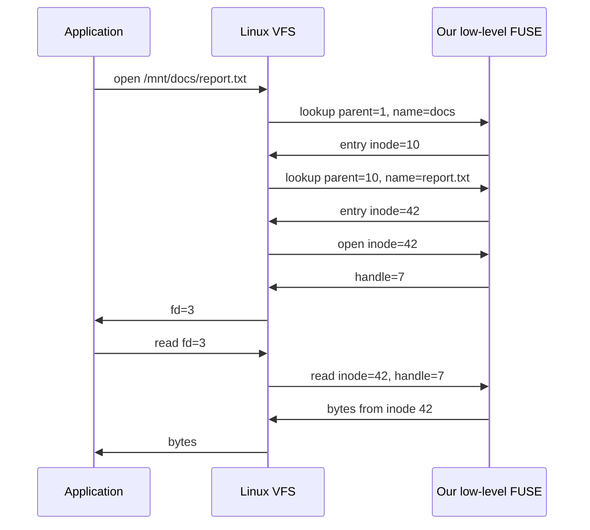
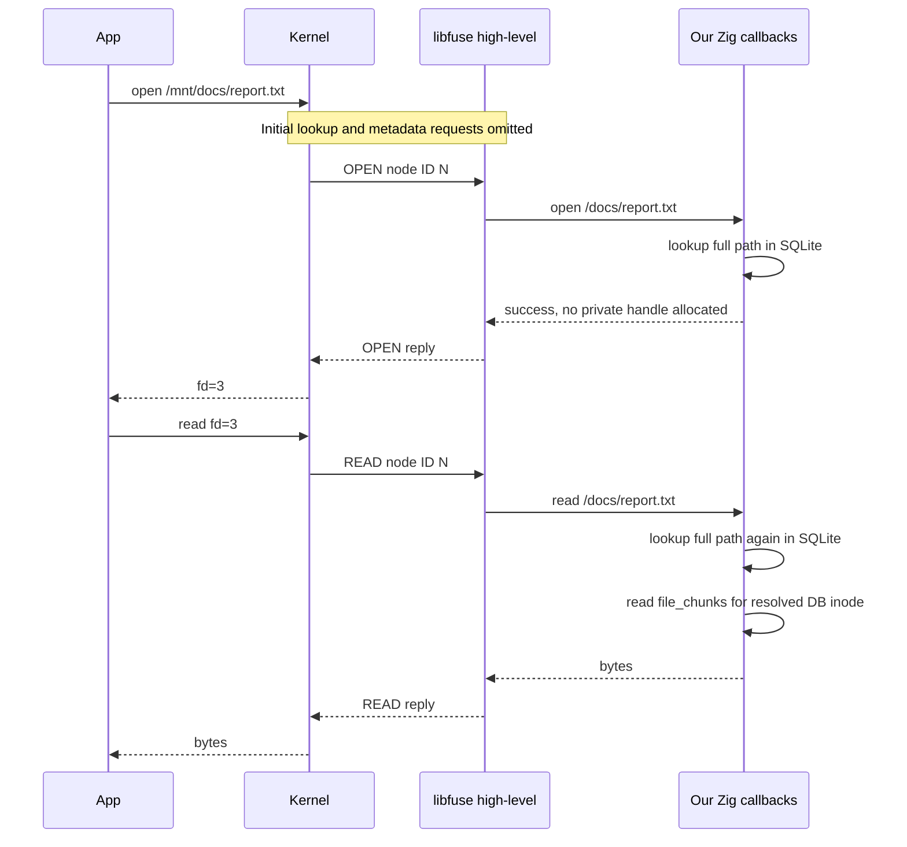

# FUSE workflows: current low-level and previous high-level APIs

The current implementation uses libfuse3's low-level, inode-oriented API. Existing file/directory operations were migrated, including open handles, lookup-reference accounting, and per-open directory snapshots. **Unlink and inode reclamation remain unimplemented.** The previous high-level workflow is retained below for comparison.

These diagrams are conceptual request flows, not runtime traces. They omit permissions, some metadata requests, and error handling. Cached names or data can avoid requests shown here. In the previous high-level API, callback paths were relative to the FUSE mount root: `/mnt/docs/report.txt` became `/docs/report.txt` when mounted at `/mnt`. Current low-level callbacks receive inode IDs or parent/name pairs, not full paths.

## Current: low-level FUSE path lookup, open, and read

The application starts with a pathname. Linux resolves it one component at a time. After reaching the mount root, the kernel asks our filesystem for each child's inode, unless a valid cached entry already exists.

- FUSE reserves inode number 1 for the mount root. The adapter swaps the database root ID and database ID 1 when necessary, preserving a collision-free bidirectional mapping. The other inode numbers above are illustrative.
- `lookup(parent, name)` queries `dirents` and returns an entry with the target inode and its attributes. It is not a full-path lookup.
- Application FD 3, filesystem-private handle 7, and inode 42 are different identifiers. The kernel manages application descriptors; our process manages handle state.
- Subsequent reads use the inode and handle. They do not need to resolve the original name again.
- The diagram collapses libfuse's low-level dispatch into our callback participant. We still use libfuse in userspace; this is not a kernel driver.

## Previous: high-level FUSE open and read

The kernel sends inode/node-ID-based FUSE protocol requests with either API. The high-level libfuse layer maintains its own name/parent mappings and translates requests into pathname callbacks for our Zig code.

The diagram starts after the initial kernel path walk. During that walk, high-level libfuse services lookup requests using our `getattr` callback with constructed paths such as `/docs` and `/docs/report.txt`. Our code resolves each supplied path against SQLite.

### What the previous code did

In `src/mount.zig` before the migration (checkpoint `8a4aa55`):

1. `open(path, fi)` calls `lookup(path)` for an ordinary open. An `O_TRUNC` open instead delegates to `truncate`, which also resolves the path.
2. `lookup(path)` starts at the database root and walks the path components using `dirents`, loading inode metadata along the way.
3. No private open handle is allocated; `fi->fh` is not populated by our code.
4. `read(path, ...)` calls `lookup(path)` again before reading the resolved inode's chunks.
5. There is no `release` callback or runtime inode-reference tracking yet.

The kernel/libfuse node ID `N` above is **not necessarily the SQLite inode ID**. Our high-level `getattr` fills `st_ino`, but that field does not by itself select the internal FUSE node identity.

The application still uses an FD for reads. It is libfuse's high-level adapter that supplies a pathname to our callback, and our code that re-resolves that pathname in SQLite—not the application or kernel restarting the original path walk for every read.

## Why the change matters for unlink

| Concern | Previous high-level implementation | Current low-level implementation |
|---|---|---|
| Child lookup | libfuse constructs paths; our code walks them | Our callback receives parent inode + child name |
| Open-file reads | Our callback resolves the supplied path again | Our callback uses inode + open handle |
| Open state | No private handle tracking | Handle-to-inode state and open references |
| Kernel inode references | Managed internally by high-level libfuse | Our adapter accounts for entry replies and `forget` |
| Unlink | Not implemented | Still pending; will remove the name and retain referenced inodes |

High-level libfuse normally handles deletion of an open file by renaming it to a `.fuse_hidden…` name and deleting that name after release. The previous adapter had no rename callback, so that mechanism was not a working unlink solution. The current low-level adapter does not use high-level hiding, but still needs an unlink transaction and explicit reclamation.

With the planned low-level design, removing `report.txt` deletes its directory entry but leaves inode 42 usable through existing references. Recreating `report.txt` creates a different inode; old descriptors must not switch to it.

For regular files, final reclamation requires all three to be zero: persistent `nlink`, runtime open references, and runtime kernel lookup references. Crash-leftover recovery still needs a separate policy.

## Current adapter details

- `src/mount.zig` registers `fuse_lowlevel_ops` through `fuse_session_new_fn`, mounts, and runs the single-threaded session loop; the database lock remains held through teardown.
- `src/store.zig` implements inode-based SQLite operations. `setattr` combines resizing and timestamp changes in one transaction. General chmod/chown remain unsupported.
- `src/runtime.zig` tracks handles and separate lookup/open references. `release` and `forget` update volatile state only; they do not delete persistent rows.
- Directory handles keep immutable snapshots with index-based continuation cookies. Reopen a directory to see entries created after its snapshot.
- Writeback caching stays disabled. Writes use current request flags, so `fcntl` changes to O_APPEND and mmap write offsets are not overridden by stale open-time flags.
- Debug-only traces now show inode IDs or parent/name pairs. A full pathname is no longer supplied to the callbacks.
- `tests/lowlevel_smoke.py` is an explicitly invoked unprivileged mount test. It creates fresh data, unmounts, and retains artifacts; obtain authorization before running it.
