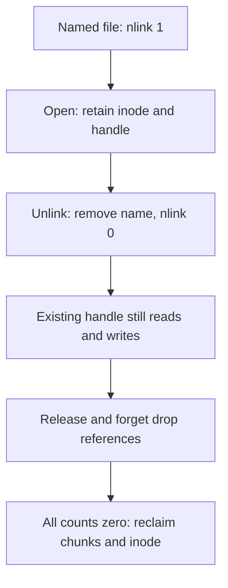

# Unlink: steps, nlink, and inode lifetime

**Status:** unlink and reclamation are design/explanation only, not implemented behavior. The low-level FUSE adapter, open-handle tracking, and lookup-reference accounting now exist, preserving existing operations. The selected next direction is Linux-style unlink lifetime; crash-orphan recovery policy is still unresolved.

## 1. What unlink removes

A pathname reaches an inode through directory entries:

```text
Directory inode 10:
    "report.txt" -> inode 42 -> metadata and file chunks
```

`unlink("report.txt")` removes that directory entry. It does **not necessarily delete inode 42 or its contents immediately**.

Separate two operations:

- **Unlink:** remove one name from the namespace.
- **Reclamation:** delete the inode and its chunks once nothing needs them.

Unlink does not truncate the file or erase the contents for applications that already have it open. Directories are removed with `rmdir`, not this unlink operation. Symlinks are outside our current schema; in Linux, unlinking a symlink removes the symlink itself, not its target.

## 2. The role of nlink

`inodes.nlink` is the persistent hard-link count, exposed as `stat.st_nlink`.

For a **regular file**, it counts directory entries pointing to that inode—not open descriptors, processes, or FUSE lookup references.

| Event | Change to the regular file's nlink |
|---|---|
| Create a new named file | Starts at 1 |
| Create another hard link to it | Increment by 1 |
| Open, read, write, or close it | No change |
| Duplicate an open descriptor | No change |
| Remove one of its names with unlink | Decrement by 1 |
| Rename its name without replacing another inode | No change to that file's count |
| Remove its last name | Becomes 0 |

Hard-link creation is an illustration of the count, not an implemented project feature.

### Two names, one inode

```text
report.txt ----+
              +--> inode 42, nlink=2 --> same contents
backup.txt ----+
```

1. Unlink `report.txt`: inode 42 has `nlink=1`; `backup.txt` still works.
2. Unlink `backup.txt`: inode 42 has `nlink=0`; neither name remains.
3. If live references still exist, retain the inode and contents until they are gone.

**nlink=0 means "no hard-link names remain", not "safe to delete right now".** Our schema already permits zero for this reason. SQLite does not automatically maintain nlink when a dirent is deleted; Zig must update both in one transaction.

Directories have different accounting: our current convention starts them at 2 and increments the parent's count for each immediate subdirectory. Do not apply the regular-file name-count formula to directories. Unlinking a regular file does not change its parent directory's nlink.

## 3. Three counts with different jobs

The current low-level adapter distinguishes these counts; unlink will use them for reclamation:

| Count | Stored where | Meaning |
|---|---|---|
| `nlink` | SQLite | Persistent hard-link names for a regular file |
| Open references | Process memory | Live filesystem open instances |
| Kernel lookup references | Process memory | Inode references obtained by the kernel through entry replies |

- `open` and the open part of `create` establish open state, identified through `fi->fh`.
- `release` ends an open instance. It is not issued for every individual descriptor close: `dup` and `fork` can share an open instance. Mappings can also prolong its lifetime.
- Entry replies from operations such as `lookup`, `mkdir`, and `create` establish kernel lookup references. `forget` releases the reported number of those references; it does not remove names.
- An `O_PATH` descriptor may retain an inode without an ordinary FUSE `open` handle. Open counts alone are insufficient.
- `flush` is not final release and must not be used as the reclamation signal.

For the planned regular-file implementation, reclaim only when:

```text
nlink == 0 AND open_refs == 0 AND lookup_refs == 0
```

This rule assumes the adapter correctly accounts for every reference it establishes and any additional references introduced by future features.

## 4. Steps involved in unlink

### Step 1 — The application requests removal

The application calls an unlink-family syscall, often through `rm`. Linux resolves the parent directory and identifies the final name. For example, `/projects/report.txt` becomes:

```text
parent inode = 10
name = "report.txt"
```

The planned unlink callback in our low-level adapter receives `unlink(request, parent_inode, name)`, not the full path. FUSE node IDs must map consistently to database inode IDs.

### Step 2 — Validate the request

Keep `default_permissions` so Linux performs the permission checks delegated to it, including relevant directory/sticky-bit rules. Removal generally depends on the containing directory's permissions, not whether the target file is writable.

Inside the mutation transaction:

1. Verify that the parent exists and is a directory.
2. Find the exact `(parent_inode, name)` dirent and load its target inode.
3. Report a missing name as `ENOENT`; distinguish it from database failures.
4. Reject directory targets and protect the root; `rmdir` is separate.
5. Verify that the target's nlink is positive and that the mutation will not underflow it. Treat inconsistent storage as an error, not permission to delete more data.

### Step 3 — Remove the name and update metadata atomically

In one SQLite transaction:

1. Delete exactly the selected dirent.
2. Decrement the target inode's nlink by one.
3. Update the target inode's ctime: its link status changed.
4. Update the parent directory's mtime and ctime: its entries changed.
5. Leave the target file's size, contents, atime, and mtime unchanged by unlink itself.
6. Leave the parent directory's nlink unchanged for regular-file unlink.

Check the expected rows were affected. If any operation fails, roll back all of them: do not leave a removed name with an unchanged count, or an existing name with a decremented count.

### Step 4 — Decide whether reclamation is already safe

After decrementing nlink, inspect the runtime reference counts:

- **nlink > 0:** another name still exists; retain the inode and chunks.
- **nlink = 0, but references remain:** retain them as an unlinked live file.
- **All three counts are zero:** delete its chunks, then its inode, in the same transaction when reclaiming as part of unlink.

The deletion order matters because `file_chunks.inode_id` references `inodes`. The schema intentionally has no cascading deletes.

The current mount is single-threaded. Any future concurrent implementation must synchronize namespace mutation, reference updates, and reclamation so a new reference cannot race with deletion.

### Step 5 — Commit, then report success

Commit the transaction before sending a successful low-level reply (`fuse_reply_err(request, 0)`). Errors use a positive errno in low-level replies; our internal storage helpers still return negative errno and the adapter converts them.

After success, a fresh lookup of the removed name fails unless someone has recreated it. Existing descriptors still identify the old inode.

### Step 6 — Continue serving live references

Once unlink is added, an open unlinked file must still support our existing read, write, truncation, metadata-read, and timestamp-update functionality through its live references.

The migrated operations already use inode identity/open state rather than looking up a path. A descriptor metadata query reports nlink=0 after the final name is removed.

Recreating the same pathname creates a different inode. Never redirect an old handle to the new object by resolving the pathname again.

### Step 7 — Reclaim after the final references disappear

Once reclamation is implemented, both `release` and `forget` must call a shared reclamation check after reducing their respective counts. Do not assume a particular arrival order.

When all three counts are zero, transactionally delete chunks and then the inode. Retain enough bookkeeping to retry failed cleanup and log failures: `release` errors are not a reliable way to report deletion problems to the application, and `forget` has no ordinary error reply.

## 5. Example: open, unlink, read, close



Closing one descriptor does not necessarily reach the last step. Other opens, shared descriptors, mappings, or kernel lookup references may still retain the object.

## 6. Implementation progress and remaining work

1. **Done:** reusable inode-based SQLite operations in `src/store.zig`, reusing the chunk read/write logic and combining resize/timestamp changes.
2. **Done:** migration of the session-wide adapter to low-level FUSE while preserving existing operations.
3. **Done:** lookup/open-reference accounting in `src/runtime.zig`, header-derived `fi->fh` access, handles, `release`, and `forget`. These callbacks do not reclaim persistent objects yet.
4. **Pending:** the unlink transaction and shared reclamation helper described above.
5. **Partly done:** session teardown frees volatile state without assuming final forget/release callbacks. Persistent zero-link cleanup at shutdown remains part of the future reclamation/recovery design.
6. Decide crash recovery separately. A crash can leave persistent zero-link inodes while volatile reference maps disappear. The advisory database flock alone does not justify automatic orphan deletion: cooperating access and stable-path assumptions still matter.

No schema change appears necessary for the basic lifecycle. Do not implement startup orphan deletion before its recovery policy is settled.

## 7. Validation checklist

- Unlink a closed file; confirm the name disappears and eventual storage reclamation.
- Unlink an open file; continue reading, writing, resizing, and inspecting it with nlink=0.
- Recreate the same name; verify old and new descriptors access different inodes.
- Exercise multiple independent opens, duplicated descriptors, O_PATH references, and release/forget ordering.
- Check missing-name and directory-target errors and unchanged parent nlink.
- Inject failures during dirent/count/timestamp changes and reclamation; verify rollback and retry behavior.
- Check SQLite integrity, foreign keys, link-count consistency, and absence of prematurely deleted inodes or leaked chunks.
- Start with in-memory tests. Fresh-mount, crash, privileged, and cleanup testing require appropriate explicit authorization; do not use an existing filesystem database as an experiment.

Related explanations: [FUSE workflows](FUSE_WORKFLOWS.md), [generic Linux filesystem notes](LINUX_FILESYSTEM_NOTES.md), and [project status](STATUS.md).
